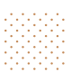
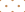
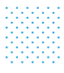
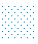
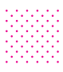
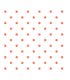
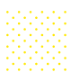
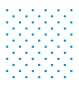

# Area ornaments

71 area ornaments (fill patterns) from section 3 of BGS RR/01/01, extracted as vector SVG from the PDF drawing operators.

## Files

| Path | Contents |
|---|---|
| `swatch/{REF}.svg` | The swatch exactly as printed in the report. |
| `tile/{REF}.svg` | A repeat tile for use as a fill pattern (transparent background, so a colour fill can sit underneath). |
| `ornaments.csv`, `ornaments.json` | Catalogue: reference name, description, colours, tile size and how the tile was made. |
| [`../Sprites/`](../Sprites) | MapLibre sprite: image name `orn-{REF}`, use with `fill-pattern`. |

## How the repeat tiles were made

- **Exact repeat (55)**: the repeat period was measured from the swatch by autocorrelation, and the tile is one period cropped from the vector artwork. These tile seamlessly.
- **Wrapped marks (13)**: the hand-placed, irregular patterns (sand, igneous, lava, breccia and so on) have no repeat. Each mark whose centre falls inside the tile is kept whole and copied across the opposite edge, so the tile is seamless but the marks near its edges are re-arranged relative to the printed swatch.
- **Cropped swatch (3)**: dense irregular tessellations (coursed rubble, random rubble, marble), where wrapping would make stones overlap. These show a faint seam every tile width.

Black in the PDF is a rich black (`#231f20`); it has been output as pure black. *Marine overprint (white)* is printed black in the report and is reproduced as printed. Colour it white yourself if needed.

## Catalogue

| Swatch | Tile | Reference | Description | Tile |
|:---:|:---:|---|---|---|
|  |  | `AGGLOM` | Agglomerate | exact repeat |
|  |  | `ANHY` | Anhydrite | exact repeat |
|  |  | `ARE_ST` | Arenaceous seatearth | exact repeat |
|  |  | `BLSND` | Blown sand | exact repeat |
|  |  | `BCLAY` | Boulder clay | exact repeat |
|  |  | `BREC` | Breccia | wrapped marks |
|  |  | `CALTUF` | Calcareous tufa | exact repeat |
|  |  | `CAT` | Cataclastic rock | exact repeat |
|  |  | `CHLK` | Chalk | exact repeat |
|  |  | `CLST` | Claystone | wrapped marks |
|  |  | `CONG` | Conglomerate | exact repeat |
|  |  | `CRSRB` | Coursed rubble | cropped swatch |
|  |  | `CR_RCK` | Crushed rock | exact repeat |
|  |  | `DIST` | Disturbed ground | exact repeat |
|  |  | `DOLOM` | Dolomite | wrapped marks |
|  |  | `FOUND` | Foundered strata | exact repeat |
|  |  | `STIPP` | General overprint stipple | exact repeat |
|  |  | `GNEISS` | Gneiss | wrapped marks |
|  |  | `GRAN` | Granite | exact repeat |
|  |  | `GRAN_V` | Granite veining | wrapped marks |
|  |  | `GR_SCH` | Graphitic schist | exact repeat |
|  |  | `GRAV` | Gravel | exact repeat |
|  |  | `GWACKE` | Greywacke | wrapped marks |
|  |  | `GYPS` | Gypsum | exact repeat |
|  |  | `IG` | Igneous | wrapped marks |
|  |  | `INFILL` | Infilled ground | exact repeat |
|  |  | `LASC` | Landscaped ground | exact repeat |
|  |  | `LAND` | Landslip | exact repeat |
|  |  | `LAVA` | Lava | wrapped marks |
|  |  | `LAV_TU` | Lava and tuff | exact repeat |
|  |  | `LMST` | Limestone | exact repeat |
|  |  | `LMST_D` | Limestone bands | exact repeat |
|  |  | `LMST_B` | Limestone beds | exact repeat |
|  |  | `LMST_T` | Limestone thin bed partings | exact repeat |
|  |  | `MADE` | Made ground | exact repeat |
|  |  | `MARBLE` | Marble | cropped swatch |
|  |  | `MARINE` | Marine overprint (white) | exact repeat |
|  |  | `LMST_M` | Massive limestone | exact repeat |
|  |  | `METASD` | Metasediment | exact repeat |
|  |  | `MIGM` | Migmatisation | exact repeat |
|  |  | `LMST_G` | Mixed group with calc-schist/ limestone | exact repeat |
|  |  | `MDST` | Mudstone | exact repeat |
|  |  | `LMST_O` | Ooidal limestone | exact repeat |
|  |  | `ST_BLK` | Overprint stipple for various rock types Black | exact repeat |
|  |  | `ST_CYN` | Overprint stipple for various rock types Cyan | exact repeat |
|  |  | `ST_MAG` | Overprint stipple for various rock types Magenta | exact repeat |
|  |  | `ST_OR` | Overprint stipple for various rock types Orange | exact repeat |
|  |  | `ST_YEL` | Overprint stipple for various rock types Yellow | exact repeat |
|  |  | `PEBBLE` | Pebbles | exact repeat |
|  |  | `PEG` | Pegmatite or vein complexes | exact repeat |
|  |  | `PELITE` | Pelite | exact repeat |
|  |  | `LMST_P` | Pisoidal limestone | exact repeat |
|  |  | `PSAMM` | Psammite | wrapped marks |
|  |  | `QUART` | Quartzite | exact repeat |
|  |  | `RNRBL` | Random rubble | cropped swatch |
|  |  | `RECL` | Reclaimed ground | exact repeat |
|  |  | `GNE_RW` | Reworked gneisses | exact repeat |
|  |  | `LMST_R` | Rubbly limestone; poorly bedded | wrapped marks |
|  |  | `SAND` | Sand | wrapped marks |
|  |  | `SNDST` | Sandstone | exact repeat |
|  |  | `LMST_S` | Sandy limestone | wrapped marks |
|  |  | `SHALE` | Shale | exact repeat |
|  |  | `SHMRL` | Shell marl | exact repeat |
|  |  | `SLTST` | Siltstone | exact repeat |
|  |  | `SLTMD` | Silty mudstone | exact repeat |
|  |  | `SLTSND` | Silty sandstone | exact repeat |
|  |  | `SALT` | Sodium salt | exact repeat |
|  |  | `TUFF` | Tuff | exact repeat |
|  |  | `TURB` | Turbidite | wrapped marks |
|  |  | `WORK` | Worked ground | exact repeat |
|  |  | `XENO` | Xenoliths | exact repeat |
