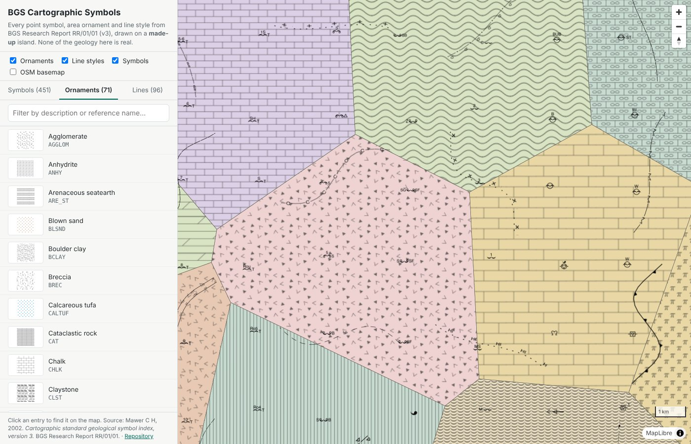

## BGS Cartographic Symbols

The BGS standard geological map symbology (point symbols, area ornaments and line styles) as reusable SVG files, catalogues and MapLibre sprites. The layout follows the [OS GeoDataViz Toolkit](https://github.com/OrdnanceSurvey/GeoDataViz-Toolkit).

Everything here was extracted programmatically from:

> Mawer C H. 2002. *Cartographic standard geological symbol index. Version 3.* British Geological Survey Research Report RR/01/01. ISBN 0 85272 402 0. © NERC 2002.

The source PDF is in [`source/`](source).

**[▶ Live MapLibre demo](https://koalageo.github.io/bgs-cartography/v3/)**: every symbol, ornament and line style drawn on a made-up island (*Isle of Mawer*, in the Celtic Sea).



| | Count | Folder | Formats |
|---|---:|---|---|
| Point symbols | 451 | [Symbols](Symbols) | SVG at BGS standard size, 24 px and 48 px SVG icons, CSV/JSON catalogue |
| Area ornaments | 71 | [Area-Ornaments](Area-Ornaments) | SVG swatch and seamless repeat tile, CSV/JSON |
| Line styles | 96 | [Line-Styles](Line-Styles) | SVG swatch and repeat tile, CSV/JSON |
| MapLibre sprite | 618 images | [Sprites](Sprites) | `bgs-symbology[@2x].json/png` |
| GIS styles | | [Styles](Styles) | QGIS symbol library + layer styles, GeoServer SLD |
| Hosting | | [serve](serve) | Published URL layout, nginx container, Kubernetes example |

## Symbols

Point symbols are grouped as in the report: Drift (artificial, mass-movement, aeolian, organic, fluvial and river terraces, lacustrine, marine, raised marine, glacial, landform, and so on), Rock, Structural (bedding, cleavage, foliation, linear structures, igneous, folds, faults) and Other.

The report's symbols are glyphs in seven embedded symbol fonts. They were converted straight from the font outlines, so they are exact vectors, not traces. The BGS standard size is kept: the average symbol body is 3 mm at 1:25 000 and smaller scales, and 4 mm at 1:10 000.

_[Symbols catalogue →](Symbols)_

## Area ornaments

Fill patterns for lithologies and overprints (limestone, sandstone, made ground, stipples in five colours, and so on). Each comes as the printed swatch and as a **repeat tile** for fills. Where the pattern is regular, its period was measured and the tile repeats exactly. The irregular, hand-placed patterns have been made seamless by wrapping marks across the tile edges. Three dense rubble and marble textures are plain crops and show a faint seam (see the folder README).

_[Area ornaments catalogue →](Area-Ornaments)_

## Line styles

Boundaries, faults, fold axial traces, coal and marine bands, glacial and landform features. Each comes as the printed swatch and as a repeat tile for `line-pattern`. The report does not give line styles reference names, so ids are slugs of the descriptions.

_[Line styles catalogue →](Line-Styles)_

## Using them in other applications

Everything is published as static files under one versioned URL, with a machine-readable manifest at [`v3/index.json`](https://koalageo.github.io/bgs-cartography/v3/index.json):

```
…/v3/sprites/bgs-symbology            MapLibre sprite   (icon-image 'sym-ALV', fill-pattern 'orn-LMST', line-pattern 'line-fault_thrust_observed')
…/v3/symbols/svg/{REF}.svg            SVG for Leaflet, OpenLayers, GeoServer, ArcGIS
…/v3/styles/geoserver/*.sld           GeoServer styles
…/v3/styles/qgis/*.xml | *.qml        QGIS symbol library / layer styles
```

No tile server is needed. GitHub Pages works, as does the nginx container in [serve](serve), which sets the CORS and content-type headers and runs on Kubernetes. See [serve](serve) for which client uses what, and [Styles](Styles) for the GIS styles.

See [Sprites](Sprites) for a minimal MapLibre style, and [`docs/index.html`](docs/index.html) for the demo source. The demo data (`docs/data/*.geojson`) is generated by `scripts/make_demo_data.py` and is **entirely fictional**.

## Rebuilding

```bash
pip install pymupdf fonttools cairosvg pillow numpy shapely scipy   # + PyQGIS for Styles/QGIS (Ubuntu 24.04: apt install python3-qgis)
scripts/build_all.sh                      # regenerate every asset from source/RR01001.pdf
scripts/assemble_site.sh && python3 -m http.server -d _site 8000   # preview at http://localhost:8000/v3/
BASE_URL=https://your.host/symbology/v3 scripts/build_all.sh           # point SLDs/manifest at another host
```

GitHub Pages deploys from `.github/workflows/pages.yml` on every push to `main`. To enable it: **Settings → Pages → Build and deployment → Source: GitHub Actions**. The container image (`.github/workflows/image.yml`) is built only when you push a `v*` tag or run the workflow by hand.

| Script | Purpose |
|---|---|
| `parse_symbols.py` | Reads the section 2 tables: description, reference name, and the glyph (font + glyph id) for each symbol |
| `build_symbols.py` | Classification headings, glyph → SVG, catalogue |
| `extract_patterns.py` | Sections 3 and 4: grid detection, PDF drawings → SVG, repeat detection |
| `wrap_tiles.py` | Seamless tiles for irregular ornaments |
| `build_sprites.py` | PNG rendering and sprite packing |
| `make_demo_data.py`, `make_readmes.py` | Demo GeoJSON and folder catalogues |
| `make_web_styles.py` | GeoServer SLDs and `index.json` for a given base URL (standard library only) |
| `make_qgis_styles.py`, `check_qgis_styles.py` | QGIS libraries and QML styles, built with PyQGIS; render check |
| `assemble_site.sh` | The published tree (Pages and container) |
| `preview.py` | Contact sheets comparing swatches with tiled output (for checking) |

## Caveats

- This reproduces a **2002** standard (version 3). Check it is still the current BGS standard before using it for production maps.
- Descriptions are as printed, including the report's spellings (e.g. "recumbant", "grandiorite").
- The report itself is inconsistent in a few places (two symbols disagree between its sections 2.1 and 2.2, and horizontal and inclined flow jointing share one glyph). These are listed in [Symbols](Symbols#source-inconsistencies).
- Pure black replaces the report's rich black (`#231f20`). Spot colours (cyan `#0091d6`, magenta `#ec008c`, orange `#f36f51`, yellow `#ffe800`, brown `#c38957`) are as printed in the PDF, which may not exactly match the original print specification.
- Repeat tiles are derived artwork. See the Area-Ornaments and Line-Styles READMEs for how each one was made and which are approximate.

## Licence

**To be confirmed before publication.** The symbology and source report are © NERC 2002 (now UKRI). See [LICENCE.md](LICENCE.md).
